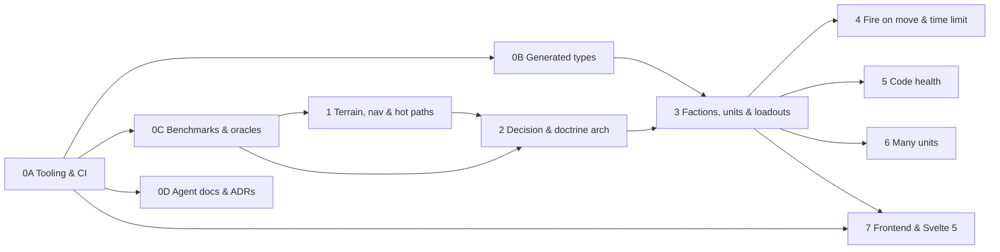

# Improvement Plan

Status: in progress (updated 19 November 2026 against `main` `0acc5c8`). Phase 0 (0A, 0B, 0C, 0D) is complete; Phase 1 is next. Approved decisions are recorded in [docs/decisions/](docs/decisions/README.md) and summarized in [Decisions](#decisions) at the end.

This file is the single tracker for this work. Agents check off items in the same change that completes them.

## Goals

1. **Agent-safe maintainability.** This repository is primarily built and maintained by agents with human oversight. Rules that matter must be enforced by tools and CI, behavioural shifts must be surfaced automatically, and decisions must live in the repository rather than chat history.
2. **Performance that scales.** Large maps, dense obstacles, and later many units must not stall the simulation. The ambition in [SCALE.md](SCALE.md) is major; the architecture should support it now while measurements govern each optimisation.
3. **Future-proof data model.** Any number of factions; many unit types; game-wide base items/weapons with custom per-scenario and per-unit loadouts.
4. **Doctrine architecture and requested gameplay.** A composable decision structure rather than growing `if` chains; fire on the move as a doctrine choice; a user-editable time limit with a no-limit option.
5. **Clean, readable code across both Rust and TypeScript/Svelte.** Generated cross-language types, enforced formatting/linting, full Svelte 5 runes migration, smaller files, and typed enums.

Guardrail ([AGENTS.md](AGENTS.md) rule 9): future-proofing means **data shapes, boundaries, and verification**, not unrequested features. Do not add an alliance UI, loadout editor UI, ECS library, worker threads, or shared memory until a later task asks for them or measurements require them.

## Baseline (`0acc5c8` + `sim-bench`, native release, 8 v 8, Cover doctrine)

Recorded from `npm run bench:rust` (`crates/sim-bench`, 40 s wall-time cap per scenario, 3,600-step limit):

| Scenario | Steps | Mean (ms) | p99 (ms) | Worst (ms) | >50 ms | Result |
| --- | ---: | ---: | ---: | ---: | ---: | --- |
| `training-fastest` | 746 | 0.543 | 11.99 | 31.16 | 0 | elimination |
| `training-protected` | 477 | 4.203 | 42.36 | 59.40 | 1 | elimination |
| `ridge-fastest` | 3600 | 0.252 | 4.76 | 28.86 | 0 | timeout |
| `ridge-protected` | 941 | 1.532 | 21.21 | 32.82 | 0 | elimination |
| `woodland-fastest` | 701 | 0.585 | 8.42 | 20.59 | 0 | elimination |
| `woodland-protected` | 3600 | 0.269 | 6.31 | 29.12 | 0 | timeout |
| `128x128-open-fastest` | 3600 | 0.318 | 2.91 | 381.68 | 1 | timeout |
| `128x128-open-protected` | 1405 | 0.831 | 12.68 | 372.92 | 1 | elimination |
| `128x128-obs1500-fastest` | 631 | 66.881 | 1.41 | 31,556.46 | 5 | unfinished (40 s cap) |
| `128x128-obs1500-protected` | 631 | 68.070 | 1.30 | 32,315.66 | 5 | unfinished (40 s cap) |

Mean per-stage breakdown (ms/step; `SnapJSON` is per 10 Hz published snapshot):

| Scenario | Sust | Percept | Decide | Move | PostPerc | ItemAct | Combat | SnapJSON |
| --- | ---: | ---: | ---: | ---: | ---: | ---: | ---: | ---: |
| `training-fastest` | 0.0001 | 0.0423 | 0.3047 | 0.1497 | 0.0423 | 0.0030 | 0.0008 | 0.0652 |
| `training-protected` | 0.0001 | 0.0684 | 2.8372 | 1.2232 | 0.0682 | 0.0047 | 0.0010 | 0.0727 |
| `ridge-protected` | 0.0001 | 0.0850 | 0.7619 | 0.5937 | 0.0834 | 0.0065 | 0.0009 | 0.0862 |
| `128x128-open-protected` | 0.0001 | 0.0151 | 0.0816 | 0.7142 | 0.0145 | 0.0047 | 0.0006 | 0.0613 |
| `128x128-obs1500-fastest` | 0.0001 | 0.0019 | 0.0011 | 66.8704 | 0.0014 | 0.0051 | 0.0005 | 0.0471 |
| `128x128-obs1500-protected` | 0.0001 | 0.0019 | 0.0015 | 68.0592 | 0.0013 | 0.0053 | 0.0005 | 0.0472 |

Browser baseline (pre-inventory `156c103`, Playwright desktop Chromium): 31 tests passed in ~5.6 min (~6.2 min including build); one preset stress test takes 2.2 min on its own.

The simulation step budget is 50 ms (20 Hz), and WASM is typically slower than native. Root causes confirmed by stage timings:

- Every sight, shot, and traversal query loops over **all** obstacles ([map.rs](crates/sim-core/src/map.rs) `blocked`, `visible`, `exposure`, `sweep_clear`).
- `breaks()` allocates a `Vec` on every query.
- Each route search recomputes static cell-to-cell travel times ([navigation.rs](crates/sim-core/src/navigation.rs)).
- `decide()` scans the full grid 2–4 times per decision; the investigation branch runs a sight check for every reachable cell ([decisions.rs](crates/sim-core/src/decisions.rs)).
- All units decide on the same tick (`tick % 10 == 1`), stacking decision cost into one spike.
- **Double O(n²) perception every tick:** [battle.rs](crates/sim-core/src/battle.rs) runs `observe_all` before movement and [combat.rs](crates/sim-core/src/combat.rs) runs `observe_all` again after movement, with no spatial index.
- **Per-tick inventory overhead:** `Inventory::totals()` runs linear string lookups and an O(m²) duplicate-ID scan on every `load_factor()`, `can_use()`, and `snapshot()` call (twice per snapshot); `held_weapon()` allocates a `WeaponDefinition` every tick; `UnitSnapshot` serializes full inventory entries and use counters as JSON at 10 Hz.

---

## Phase 0 — Agent foundations, verification, and measurement

Establish automated guardrails, generated contracts, behavioural visibility, and benchmarks before changing hot code or schemas.

### 0A — Tooling, boundaries, and CI

- [x] Pin the Rust toolchain ([rust-toolchain.toml](rust-toolchain.toml)) and set `rust-version` in [Cargo.toml](Cargo.toml).
- [x] Add Prettier, ESLint, and `prettier-plugin-svelte` for `apps/web`, `scripts`, and `tests`. Format the existing frontend cleanly (resolving 500–1,681-character lines in `MapMaker.svelte`, `Skirmish.svelte`, `types.ts`, `style.css`, etc.).
- [x] Enforce architectural boundaries automatically:
  - ESLint import/syntax rules ([eslint.config.js](eslint.config.js)) with regression tests ([tests/boundaries.test.mjs](tests/boundaries.test.mjs)): renderer and Svelte components cannot import Worker internals or generated WASM; presentation cannot bypass `BattleClient`; Worker cannot import PixiJS/Svelte/UI.
  - Rust lockfile/manifest/source test ([crates/sim-core/tests/boundaries.rs](crates/sim-core/tests/boundaries.rs)): `sim-core` must never depend on `wasm-bindgen`, `web-sys`, `js-sys`, `gloo`, or `wasm-streams`.
- [x] Add `cargo-deny` ([deny.toml](deny.toml)) to verify dependency licences, advisories, bans, and sources ([AGENTS.md](AGENTS.md) rule 16).
- [x] Add tiered verification scripts in [package.json](package.json) and [scripts/verify.mjs](scripts/verify.mjs):
  - `npm run verify:fast` (~90 s, run on every change): `fmt:check`, `lint:rust`, `test:rust`, `fmt:web:check`, `lint:web`, `test:boundaries`, `check:privacy`, `test:privacy`, `build`, `check`, and `@smoke` Playwright tests (7 real-browser tests across Skirmish, doctrine, inventory, Map Maker, and persistence). `npm run test:e2e:fast` runs all non-`@stress` Playwright tests.
  - `npm run verify` (run before merging and in CI): everything in `verify:fast`, plus `deny:rust` and the full Playwright suite (including `@stress` tests). Phase 0C will add `bench:rust` once `crates/sim-bench` exists.
- [x] Add [.github/workflows/verify.yml](.github/workflows/verify.yml) on GitHub Actions to run `npm run verify` with SHA-pinned actions and SHA-256-verified tool binaries. Existing [.github/workflows/privacy.yml](.github/workflows/privacy.yml) left intact.

### 0B — Generated Rust ↔ TypeScript contract

- [x] Generate TypeScript types from `sim-core` using `ts-rs` (`default-features = false`, optional `ts-export` feature, zero WASM/runtime impact) into [apps/web/src/generated/sim-types.ts](apps/web/src/generated/sim-types.ts), replacing hand-copied wire types in [types.ts](apps/web/src/lib/types.ts) (keeping only `ScenarioDocument`, `WorkerCommand`, and `WorkerReply`). Moved WASM build output to `apps/web/src/generated/wasm/`. Added `npm run gen:types`, `npm run check:types-sync` (wired into `verify:fast` and `verify`), and a Rust `serde_json` vs TS key/variant parity test.
- [x] Split `crates/sim-core/src/types.rs` into focused submodules (`crates/sim-core/src/types/{mod, map, doctrine, inventory, scenario, snapshot}.rs`) so parallel agents do not collide on one shared file.
- [x] Reduced duplicated structural validation in [scenario-library.ts](apps/web/src/lib/scenario-library.ts): kept portable JSON envelope checks and v1 → v2 doctrine migration in TypeScript, delegating scenario field/enum/numeric validation to Rust.

### 0C — Benchmarks, reference oracles, and behavioural visibility

- [x] Added native benchmark binary [crates/sim-bench](crates/sim-bench/Cargo.toml) (no new external dependencies), `npm run bench:rust`, and `npm run bench:rust:quick` (wired into `npm run verify`). Reports mean, p99, and worst step, plus zero-overhead per-stage timing across sustainment, perception, decisions, movement, post-movement perception, item actions, combat, and 10 Hz snapshot JSON serialization (`Battle::step_profiled()`).
- [x] Benchmark scenarios cover all three presets (Fastest and Protected), 128 × 128 open, and 128 × 128 with 1,500 obstacles; entity sweeps at 100, 1,000, and 5,000 units ([SCALE.md](SCALE.md)) are noted and ready to enable once Phase 3 lifts the unit cap.
- [x] Preserved current `blocked`, `visible`, `exposure`, `travel_time`, and `navigation::Search` implementations as **test-only reference oracles** in [crates/sim-core/src/oracles.rs](crates/sim-core/src/oracles.rs), verified across all presets and randomized generated maps.
- [x] Added the **standard doctrine scenario suite** (13 scenarios across engagement distance, position preference, route preference, grenades, medical care, and fallback) and headless multi-seed report tool (`npm run report:doctrine`, [crates/sim-bench/src/doctrine_suite.rs](crates/sim-bench/src/doctrine_suite.rs)) summarising win rates, behaviour time shares, shots, damage taken, cover/vegetation shares, item uses, and battle duration. (`fire_while_moving` on/off will be added in Phase 4.)
- [x] Added **statistical cross-seed tests** (`crates/sim-bench/tests/doctrine_suite.rs`, ≥ 80% across 10 seeds) and **outcome fingerprints** ([crates/sim-bench/fingerprints.json](crates/sim-bench/fingerprints.json)) checked in `npm run test:rust`.
- [x] Recorded the `sim-bench` baseline in this file.

#### Performance targets

The simulation runs in a dedicated Worker, so a slow step does not freeze the page, but exceeding 50 ms causes catch-up capping and visible slowdown.

**Browser** (desktop Chromium, mid-range laptop, WASM in Worker — acceptance targets):

| Measure | Target | Reason |
| --- | --- | --- |
| Mean step | ≤ 5 ms | 10% of 50 ms budget; room for fast-forward and slower machines |
| p99 step | ≤ 20 ms | Decision spikes remain well inside one step |
| Worst step | ≤ 40 ms | No missed ticks or catch-up |
| Any step | never > 250 ms | Beyond this, players notice a freeze |
| Map Maker analysis (128 × 128) | ≤ 100 ms | Editing feels immediate |
| Rendering | 60 fps on main thread | Independent of simulation rate |

**Native release** (benchmark proxy, roughly 2× faster than WASM): mean ≤ 2.5 ms, p99 ≤ 10 ms, worst ≤ 20 ms.

These targets apply to every preset at 8 v 8 and to 128 × 128 with 1,500 obstacles at 8 v 8. Targets for 100 / 1,000 / 5,000 units will be set after Phase 6 measurements. Mobile targets wait for a supported-device decision.

### 0D — Agent documentation, decision records, and checkpoints

- [x] Created [docs/decisions/](docs/decisions/README.md) with numbered ADRs (`0001`–`0007`) recording all approved decisions (performance targets, game-wide base materials + custom loadouts, `fire_while_moving` default off, 10-minute default / no limit / End battle, full Svelte 5 runes, CI/tooling, human-approval checkpoints).
- [x] Updated [AGENTS.md](AGENTS.md) with the 6 human-approval checkpoints, asset provenance rule, code hygiene (~400-line target + header comments), verification workflow, and expanded handoff requirements (test-edit flags and before/after doctrine report summaries).
- [x] Added focused area guides ([crates/sim-core/AGENTS.md](crates/sim-core/AGENTS.md), [apps/web/AGENTS.md](apps/web/AGENTS.md)) with module ownership, invariants, and step-by-step checklists/recipes for common tasks.
- [x] Trimmed fragile algorithm-level implementation detail from [ARCHITECTURE.md](ARCHITECTURE.md) so docs stay accurate across refactors.

---

## Phase 1 — Terrain, navigation, and hot-path performance

Behaviour should not change; Phase 0 oracles and outcome fingerprints verify equivalence.

- [ ] **Static terrain cache built once per battle** (and per analysis): per-cell obstacle height and occupancy grid (obstacles are integer-aligned rectangles, so rasterisation is exact), surface definition per cell, and blocked flags.
- [ ] Replace full-obstacle loops with grid traversal along existing break points. Preserve exact edge semantics: solid obstacles block at `>=`, ground at `>`, corner grazing blocks both directions.
- [ ] **Precompute the 8-neighbour travel-time table** once per battle. Searches read it instead of calling `travel_time` per edge.
- [ ] Make `breaks()` allocation-free (reusable buffer or iterator). Reuse search buffers (`costs`, `previous`, heap, risk cache) via a per-battle scratch struct.
- [ ] Single-goal searches (`Route::prepare`) use A* with an admissible heuristic (`distance / max_possible_speed`). Multi-target searches remain Dijkstra with early exit.
- [ ] Single-pass `advance_toward` (remove redundant `travel_time` pre-check and duplicate `breaks()` call).
- [ ] Unify `exposure` and `detectable` × `shot_fraction` behind one shared ray evaluation.
- [ ] **Eliminate per-tick inventory and perception waste introduced by `feature/inventory`:**
  - Cache `weight_grams`, `stowed_volume_ml`, and `load_factor` inside `Inventory`, updating only on mutation instead of calling `totals()` (with its O(m²) duplicate scan and string lookups) on every movement tick, `can_use()`, and snapshot.
  - Avoid running full O(n²) `observe_all` twice every tick: reuse pre-movement observations for pairs where neither unit moved or changed reveal state, or compute post-movement deltas only for moved/affected units.
  - Avoid cloning `Inventory` and heap-allocating `WeaponDefinition` strings inside the per-tick step loop.

Deferred until measured: hierarchical pathfinding, flow fields, map chunking.

---

## Phase 2 — Decision and doctrine architecture

Restructure decisions before adding more doctrine rules so the engine scales to presets, triggers, fire-on-the-move, grenades, medical care, and future equipment.

- [ ] **Candidate-action doctrine structure:** refactor `decisions.rs` and `item_actions.rs` so behaviours and item actions propose typed candidate actions that doctrine filters and scores, instead of monolithic nested `if` chains. Keep movement/tactical intentions and per-tick item/combat actions cleanly separated from execution.
- [ ] Split `decisions.rs` into per-behaviour modules: `decisions/{mod, fallback, engage, reposition, investigate, patrol}.rs`. Replace positional tuples like `(Point, f64, f64, f64, bool)` with named candidate structs and explicit comparators.
- [ ] Introduce a **`Tuning`** struct in definitions for scattered magic numbers: decision interval (`10`), memory expiry (`200` ticks, currently duplicated), tolerances (`0.01`, `0.2`, `0.3`, `0.4`), threat-moved distance (`2.0`), reposition radius (`3.0`), fallback radius (`5.0`), sustainment drain/threshold/restore constants, and grenade/medical constants.
- [ ] **Bound candidate scans** to a grid window around the unit instead of scanning the entire map. Bound the investigation search by radius or cost, checking cheap filters (cost, distance) before sight rays.
- [ ] **Stagger decisions** deterministically by unit ID (e.g., `(tick + id) % interval`) so decision costs spread across ticks while keeping event-driven early interrupts. Any work budget must be count-based, never wall-clock-based.
- [ ] Fix `Investigating` units standing still when both the remembered position and all observation spots are unreachable (empty route): mark investigated or fall back to patrol.
- [ ] **Reduce test timing fragility:** migrate unit/integration tests that assert exact positions after fixed step counts (`run(&mut b, 35)`) to behavioural ("eventually reaches X within N steps") or multi-seed statistical assertions, while keeping full tick-by-tick reproducibility tests.

Note: staggering and A* tie-breaks change exact trajectories; update outcome fingerprints with a documented explanation in the handoff.

---

## Phase 3 — Data model: factions, units, equipment, and custom loadouts

### Unit state layout

- [ ] Group the 23 fields of `Unit` in [unit.rs](crates/sim-core/src/unit.rs) into cohesive components (`Vitals`, `NavigationState`, `PerceptionMemory`, `CombatState`, `SustainmentState`, `Inventory`) so future fields (morale, armour, vehicles) do not create a monolith and packed/ECS storage remains practical later.

### Factions (any number)

- [ ] Replace `Scenario.factions: Vec<u32>` with faction definitions: `{ id, name, color, patrol_direction }`. UI reads names and colours from scenario data rather than hardcoded `['North', 'South']` or `factions[0]` checks.
- [ ] Add a single hostility query `is_hostile(a, b)` (initially `a != b`; hook for a future relations table, no alliance UI). Use it across perception, combat, grenade friendly-fire checks (`item_actions.rs`), and victory evaluation.
- [ ] Victory ends the battle when no two surviving factions are hostile to each other. Results list every faction.
- [ ] Validation requires at least two distinct factions instead of exactly two.
- [ ] Remove the faction-index patrol direction heuristic in `decide()`; read patrol direction from faction data.
- [ ] Skirmish may still default to two factions, but no code assumes two. Map Maker can add or remove factions.

### Game-wide base materials and custom loadouts

- [ ] **Base materials are game-wide.** Unit types, weapons, and items/consumables live in the shared game catalog (`UnitDefinition`, `WeaponDefinition`, `ItemDefinition`, typed `ItemUseProperties`). Scenarios cannot invent base materials.
- [ ] Separate item definitions from starting quantities: remove `initial` from `ItemSpec` in [inventory.rs](crates/sim-core/src/inventory.rs) and express starting gear as a `Loadout` on each `UnitDefinition`.
- [ ] Move remaining hardcoded constants into definitions: `MAX_HP` (removing hardcoded `100.0` in `item_actions.rs` and `combat.rs`), `SPEED`, eye height, spotting range (`14.0`), target sample heights, weapon stats, and consumable stats. Reserve a mechanical `moving_fire_multiplier` field on weapon/unit definitions (unused in the test phase).
- [ ] **Custom loadouts in scenarios.** A scenario may define named loadouts (e.g., `"Marksman"`) composed of catalog item IDs and quantities. A `UnitPlacement` keeps `definition_id` and may select a named scenario loadout or specify an inline loadout; omitting both uses the unit type's `default_loadout`.
- [ ] Validation verifies that custom loadouts reference known catalog items, fit within the unit type's weight/volume capacity, and satisfy basic slot/compatibility rules.
- [ ] Remove hardcoded `"rifle"` / `"rifle-ammo"` / `"frag-grenade"` / `"medical-supply"` / `"ration"` / `"water"` string lookups from simulation loops: resolve IDs to compact indices or typed item tags at `Battle::new`. Fix `Unit::withdrawing()` (`unit.rs`) and `InventoryDisplay.svelte` to inspect the unit's equipped weapon's ammo rather than `"rifle-ammo"`.
- [ ] Track per-slot weapon state (`WeaponState { cooldown, ... }`) so multiple weapons fit without restructuring.
- [ ] Separate **engine structural limits** (memory/safety bounds) from **mode rules** (Skirmish's 8-per-faction cap) so benchmarks and larger modes can exceed 8 per faction.
- [ ] Remove redundant catalog singletons (`Catalog.map`, `Catalog.unit`, `Catalog.weapon`) once the frontend reads the registries.

### Scenario format v3

- [ ] Bump scenario `schemaVersion` from **2** (current `feature/inventory` format) to **3** (faction definitions, custom scenario loadouts, nullable `timeLimit`, `fireWhileMoving`).
- [ ] Migrate both v1 and v2 documents in memory on load/import in [scenario-library.ts](apps/web/src/lib/scenario-library.ts) without mutating stored records automatically; add browser tests for v1 and v2 documents in IndexedDB and JSON.

---

## Phase 4 — Doctrine and gameplay features

### Fire on the move (doctrinal for test phase)

- [ ] Add `Doctrine.fire_while_moving: bool`, **default off**. Schema v1 and v2 documents migrate to off.
- [ ] Replace the hardcoded `Behavior` match in [item_actions.rs](crates/sim-core/src/item_actions.rs) with doctrine-driven eligibility: stationary behaviours may fire; moving behaviours (`Advancing`, `FallingBack`, `Investigating`) may fire only when `fire_while_moving` is enabled.
- [ ] Align grenade throwing with movement/firing rules (currently grenades in `item_actions.rs` ignore `Behavior` entirely) and document the rule in [INVENTORY.md](INVENTORY.md).
- [ ] Note behaviour change: falling-back units currently fire by default. With `fire_while_moving` defaulting to off, they stop firing while moving; update [MVP.md](MVP.md) and `fallback_can_fire_at_a_visible_enemy` to enable the doctrine explicitly.
- [ ] No mechanical accuracy penalty during the test phase (reserved field from Phase 3 stays `1.0`).
- [ ] Add a Doctrine Editor toggle and a doctrine-comparison behaviour test (same scenario and seed, on vs off produces observable shot-count differences while moving/repositioning).

### Time limit

- [ ] Change default time limit from 180 s to **600 s** (10 minutes).
- [ ] Make `time_limit` optional (`Option<f64>` / `number | null`): `None`/`null` means **no limit**; numeric limits remain within 1–3600 s.
- [ ] Add a time-limit control to Skirmish setup (Map Maker already has numeric editing): minutes input plus a "No time limit" toggle. Handle unlimited battles cleanly in the battle clock and results view.
- [ ] Add an **End battle** action for live/paused battles that concludes immediately with a draw result (`reason: stopped`) showing survivors and casualties so unlimited battles do not require a silent reset.

---

## Phase 5 — Code health and typed contracts

- [ ] Replace stringly-typed fields with enums (preserving clean wire values via serde): `ResultReason`, `IssueSeverity`, `IssueCode`, `ItemCategory`, `ItemUseKind`. Remove the error-message string match in [validation.rs](crates/sim-core/src/validation.rs) (`issue.message == "Patrol points must be on open ground."`).
- [ ] Move inventory doctrine range checks in [validation.rs](crates/sim-core/src/validation.rs) out of `structural_problem` into regular validation/analysis issues so drafts with out-of-range grenade/medical settings remain editable in Map Maker instead of being rejected as structurally unsafe.
- [ ] Replace `.expect(...)` overflow/invariant panics in `Inventory::can_use` and `Inventory::totals` with explicit error/boolean handling ([AGENTS.md](AGENTS.md) rule 12).
- [ ] Serialize `Behavior` as stable camelCase IDs (`fallingBack`) and map display labels in TypeScript.
- [ ] Consolidate unit memory (`memory`, `threat_memories`, derived `known_threats`) into one source of truth.
- [ ] Move weapon cooldown ticking out of `movement::execute` into combat/item execution.
- [ ] Decide whether `Catalog.terrain_cells` is still needed now that `analyze_scenario` supplies cell info; remove if unused.

---

## Phase 6 — Scaling to many units

Begin only after Phases 1–2 and after measuring 100 / 1,000 / 5,000 units with `sim-bench`.

- [ ] Uniform spatial grid for units, updated each tick; perception and grenade blast queries inspect only cells within range.
- [ ] Compact snapshot transport: binary typed arrays (transferable) for high-frequency unit state (position, HP, behaviour, target) once unit counts grow; send detailed inventory/sustainment data only on change or for the inspected unit rather than serializing every soldier's full inventory JSON at 10 Hz.
- [ ] Worker: build snapshots only when publishing (currently built and JSON-parsed on every pump), and emit a "simulation behind real time" indicator to the UI instead of silently slowing at the 5-step catch-up cap.
- [ ] Renderer: sprite batching and viewport culling when unit counts require it.
- [ ] Re-evaluate storage layout (packed component arrays vs ECS) against profiling data ([ARCHITECTURE.md](ARCHITECTURE.md) leaves this open).

---

## Phase 7 — Frontend structure and Svelte 5 migration

- [ ] Migrate **every** component fully to Svelte 5 runes (`$state`, `$derived`, `$effect`, `$props`), removing all `export let` and `$:` syntax (`App`, `Skirmish`, `MapMaker`, `DoctrineEditor`, `FactionPanel`, `InventoryDisplay`, `Results`, `UnitPicker`). Migrate one component at a time with browser tests green after each.
- [ ] Split [Skirmish.svelte](apps/web/src/components/Skirmish.svelte) and [MapMaker.svelte](apps/web/src/components/MapMaker.svelte) into focused subcomponents (setup controls, terrain inspector, action bar, live unit status, map tools, scenario properties).
- [ ] Split [battlefield.ts](apps/web/src/lib/battlefield.ts) into a shared map view (camera, terrain cache), a battle layer, and an editor overlay.
- [ ] Update [InventoryDisplay.svelte](apps/web/src/components/InventoryDisplay.svelte) to iterate actual unit inventory entries and equipped weapon ammo rather than `catalog.defaultLoadout` and hardcoded `'rifle-ammo'`.
- [ ] Drive faction panels, map colours, and results from scenario faction definitions (Phase 3).

---

## Phase order and dependencies

Notes for parallel work:
- Phase 0B (`types.rs` split + TS type generation), 0C (`sim-bench` + oracles), and 0D (ADRs + `AGENTS.md`) can proceed in parallel once 0A is in place.
- Formatting and Svelte 5 migration of untouched components (Phase 7) can start right after 0A; faction/loadout UI wiring waits for Phase 3.
- A numeric-only Skirmish time-limit input can ship early if wanted, while nullable `time_limit` ships with schema v3 in Phase 3/4.

## Verification for every phase

- Run `npm run verify:fast` on every change; run `npm run verify` before merging.
- Compare `npm run bench:rust` against the recorded baseline whenever touching simulation, navigation, inventory, or perception code.
- Run the headless doctrine report tool and check outcome fingerprints; any change to a fingerprint must be explained and approved.
- Keep [ARCHITECTURE.md](ARCHITECTURE.md), [MVP.md](MVP.md), [TERRAIN.md](TERRAIN.md), and [INVENTORY.md](INVENTORY.md) aligned with behavioural or contract changes, without copying implementation internals into them.

## Decisions

| # | Decision | Outcome | Phase |
| --- | --- | --- | --- |
| 1 | Performance targets | Browser mean ≤ 5 ms, p99 ≤ 20 ms, worst ≤ 40 ms, never > 250 ms; native proxy half of that | 0C |
| 2 | Custom definitions in scenarios | Base materials game-wide; scenarios define custom loadouts from them | 3 |
| 3 | `fire_while_moving` default | Off | 4 |
| 4 | Time limit | Default 10 minutes (600 s); "No time limit" option; End battle action (`stopped` draw) | 4 |
| 5 | Svelte style | Full migration to Svelte 5 runes | 7 |
| 6 | CI | Add GitHub Actions `verify.yml` alongside existing `privacy.yml` | 0A |
| 7 | New dev dependencies | Approved: `ts-rs` or `specta`, Prettier + ESLint + `prettier-plugin-svelte`, `cargo-deny` | 0A, 0B |
| 8 | Human approval checkpoints | Approved: new deps, schema version bump, doctrine meaning / fingerprint change, loosened/deleted tests, scope docs, new assets | 0D |

Still open: which machine serves as the reference "mid-range laptop" for browser measurements, and mobile targets.
