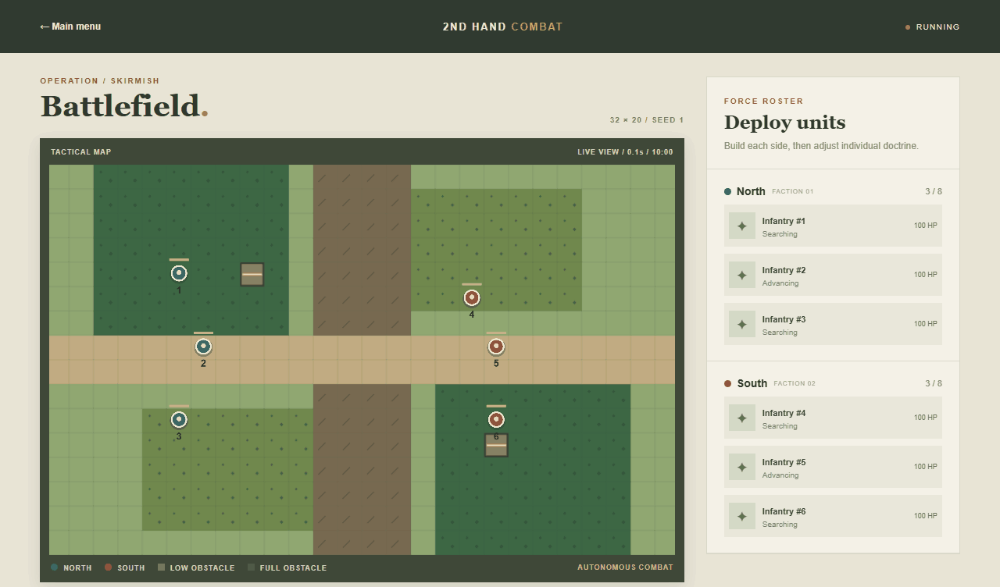
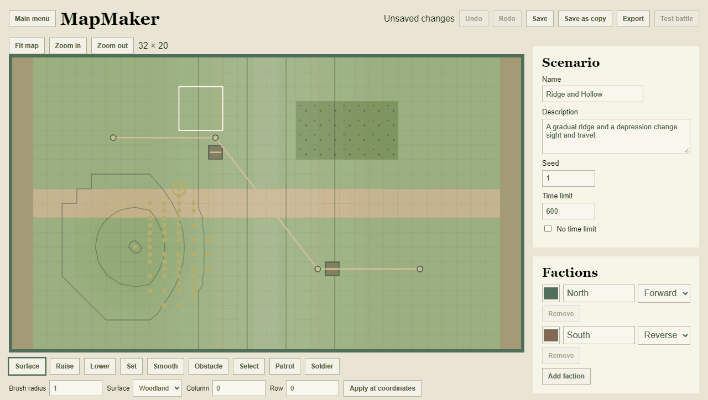

# 2nd Hand Combat

A browser strategy game where you give each soldier a doctrine before the first shot. Tell one to close the distance and another to seek cover. Once the battle starts, each soldier acts on what they can see and remember. You can see the whole field.



[Still image of the skirmish](docs/screenshots/skirmish.png)

## Your first skirmish

1. Open **Skirmish** and choose **Training Ground**. Add one infantry soldier to each side. For a quick encounter, place North at column 2, row 2 and South at column 12, row 2.
2. Select the North soldier, set **Engagement distance** to **12**, and start the battle. Watch where North takes the first shot.
3. **Reset** the battle, change only North’s engagement distance to **5**, and start again. The placements, equipment, and seed carry over. Watch how much ground North covers before opening fire this time.

A skirmish can have up to eight soldiers per faction. As you add more, try giving soldiers different rules for withdrawal, firing on the move, or spending their limited ammunition and supplies. Pause to inspect a soldier’s health, cover, and inventory. [Soldier inventory and doctrine](INVENTORY.md)

## Choose your ground

| Battlefield | What to look for |
| --- | --- |
| **Training Ground** | Watch what happens to sightlines when soldiers reach an opening in the central wall. |
| **Ridge and Hollow** | A soldier on the ridge can sometimes see over an obstacle that blocks the view from the hollow. |
| **Woodland Crossing** | Roads speed up movement, mud slows it, and woodland conceals a soldier until a shot briefly gives their position away. |

## Build a battlefield

In **Map Maker**, start with a blank map or copy one of the three built-in battlefields. Paint a road, raise a ridge, or move a patrol point. Place the two sides and choose **Test battle** to see how they use the ground. Returning to the editor brings you back to your draft.



[Still image of Map Maker](docs/screenshots/map-maker.png)

Custom maps can be up to 128 × 128 cells. Save drafts in your browser’s scenario library, or export a JSON file to back one up or pass it to another player. [Map Maker guide](MAP_MAKER.md) · [Terrain and sightlines](TERRAIN.md)

## Run locally

The current browser target is desktop Chromium. Install Node.js 22.12 or newer, Rust via `rustup`, and `wasm-pack`. From the repository root, run the following and open the local URL Vite prints.

```sh
npm ci
npm run dev
```

<details>
<summary>Development and verification</summary>

Rust runs the same fixed-step simulation in native tests and in a browser Web Worker through WebAssembly. Svelte supplies the controls and PixiJS draws the battlefield. Restart `npm run dev` after changing Rust to rebuild the WASM adapter. [Architecture](ARCHITECTURE.md) · [Playable scope](MVP.md)

`rustup` reads the pinned toolchain, components, and WASM target from `rust-toolchain.toml`. On Windows, the MSVC toolchain needs Visual Studio C++ build tools. The repository also recognizes a local GNU toolchain under `.tools` when present.

| Task | Command |
| --- | --- |
| Install Chromium for Playwright tests | `npx playwright install chromium` |
| Run the everyday checks and browser smoke tests | `npm run verify:fast` |
| Run full pre-merge verification (requires `cargo-deny`) | `npm run verify` |
| Compare doctrine across seeds | `npm run report:doctrine` |
| Build the static site in `dist/` and serve it locally | `npm run build`, then `npm run preview` |

The full script list includes focused Rust, browser, benchmark, and formatting commands. Background-tab pause still needs a manual check in a real browser tab. [Package scripts](package.json)

</details>

<details>
<summary>Sensitive information checks</summary>

Run `npm run check:privacy` for current project files and `npm run test:privacy` for its regression tests. The GitHub workflow also scans fetched Git history with a pinned, checksum-verified Gitleaks release. Findings identify locations and rules. The checks cover current text and Git history separately. Review images and their metadata separately before sharing them. [Privacy workflow](.github/workflows/privacy.yml)

</details>

## Licensing status

No license has been granted for reuse. An open-source or possibly Creative Commons release is under consideration.

The GIFs and still images were captured from the project’s own desktop Chromium build at `2908ea2` for this README. The project’s licensing status applies to these captures.
